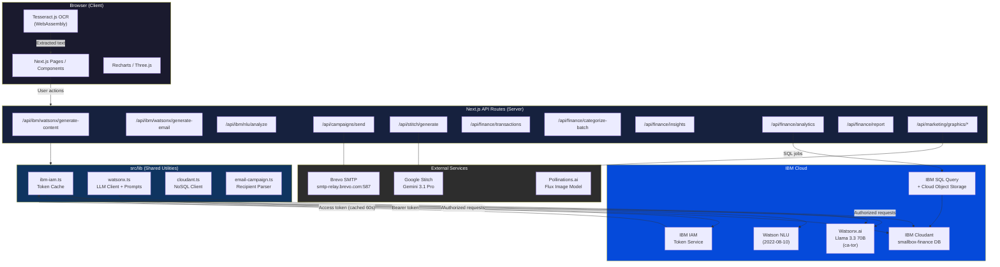
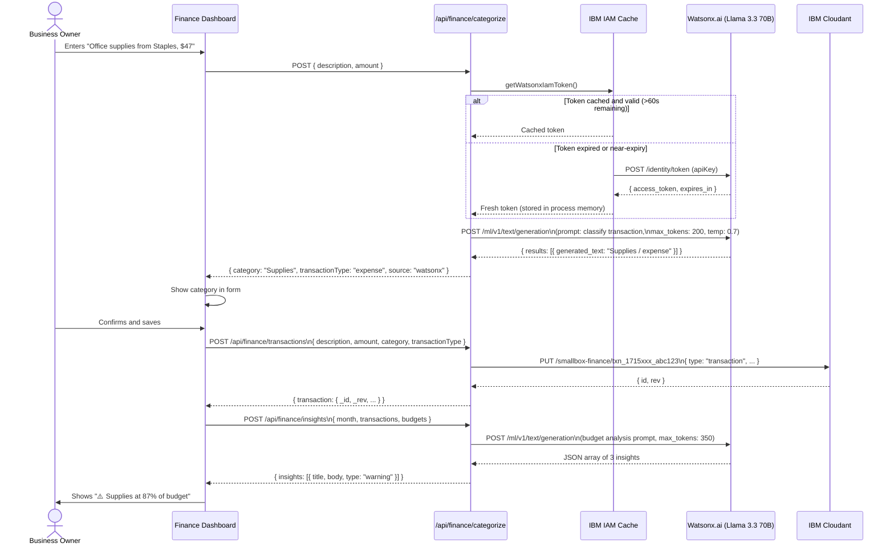
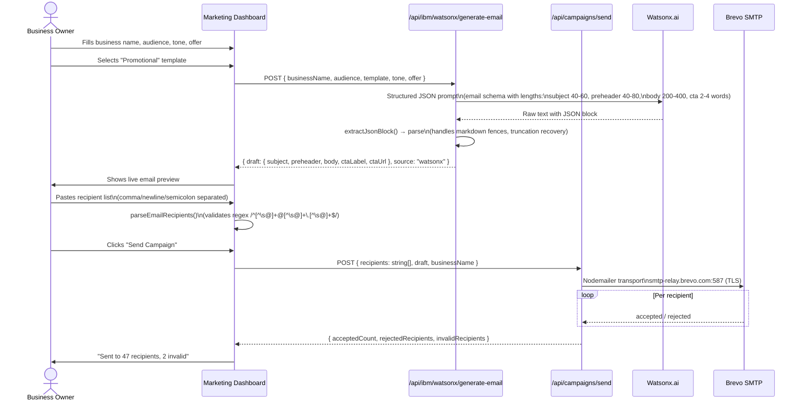
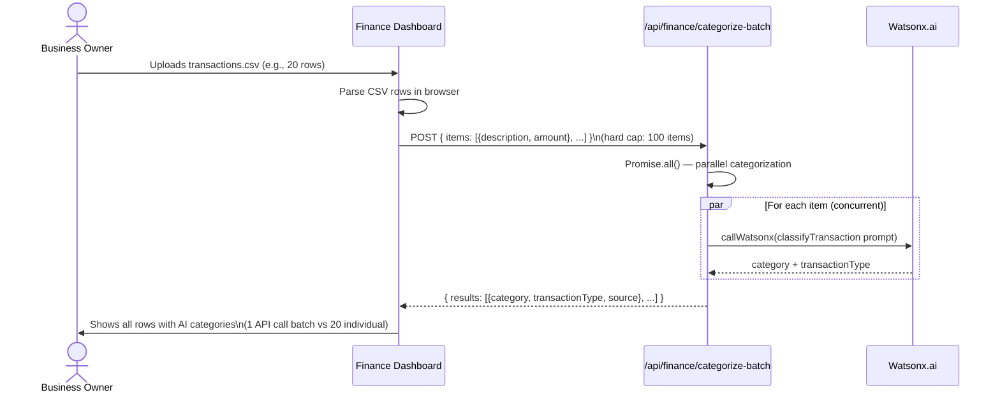

# SmallBox — Interview Preparation Guide
### Tailored for: IBM Data Scientist Intern Role

---

## Table of Contents
1. [Elevator Pitch](#1-elevator-pitch)
2. [Problem Statement](#2-problem-statement)
3. [Tech Stack](#3-tech-stack)
4. [System Architecture](#4-system-architecture)
5. [Data Flow — End to End](#5-data-flow--end-to-end)
6. [Core Technical Component Deep Dive](#6-core-technical-component-deep-dive)
7. [Supporting Systems](#7-supporting-systems)
8. [Key Engineering Decisions & Trade-offs](#8-key-engineering-decisions--trade-offs)
9. [Performance Metrics](#9-performance-metrics)
10. [Interview Questions & Answers](#10-interview-questions--answers)
11. [Quick Reference Cheat Sheet](#11-quick-reference-cheat-sheet)

---

## 1. Elevator Pitch

### 30-Second Version
> "SmallBox is an AI-powered business operating system built specifically for micro and small businesses in emerging markets. It integrates IBM Watsonx.ai's foundation models for content generation, Watson NLU for sentiment analysis, IBM Cloudant as the persistence layer, and IBM SQL Query for business analytics — all behind a single Next.js dashboard. A small business owner can generate marketing copy, scan receipts with on-device OCR, track budgets with AI categorization, send email campaigns, and get AI-generated financial insights — without needing a technical background. I built this for the IBM UNSA Hackathon, aligning with UN SDGs 8, 9, and 10."

### Key Numbers to Memorize

| Metric | Value |
|--------|-------|
| IBM foundation model used | Meta Llama 3.3 70B Instruct (via Watsonx.ai) |
| Watsonx.ai max tokens | 2,048 |
| Watsonx.ai temperature | 0.7 |
| Finance insights token budget | 350 tokens |
| Monthly report token budget | 160 tokens |
| Content generation token budget | 350–600 tokens |
| Budget warning threshold | 80% of budget |
| Budget exceeded threshold | 100% of budget |
| Unused budget alert | ≤30% (only if budget > $100) |
| Batch categorization hard cap | 100 items |
| Cloudant query limit | 1,000 documents |
| Brevo free-tier email limit | 300 emails/day |
| Content variations returned | Always exactly 3 |
| Analytics metrics calculated | 5 per request |
| IAM token pre-refresh window | 60 seconds before expiry |
| SQL Query job timeout | 30 seconds (1.5s poll interval) |
| Dashboard beam count | 15 (reduced from 30 for performance) |
| Budget categories | 8 (Supplies, Marketing, Utilities, Rent, Payroll, Insurance, Equipment, Other) |
| Transaction categories | 9 (above + Sales) |
| Graphics image providers | Pollinations.ai (Flux model) |
| Website builder model | Gemini 3.1 Pro (Google Stitch SDK) |
| Stitch Project ID | 9080752046954043293 |
| API routes | 15+ |
| React components | 50+ |

---

## 2. Problem Statement

### Who It's For
Micro and small business (SMB) owners — particularly in Latin America and emerging markets — who operate without dedicated marketing teams, finance departments, or data analysts. These owners need professional-grade tools but can't afford enterprise SaaS subscriptions or the technical overhead of stitching tools together.

### What Existing Solutions Miss

| Gap | Existing Tool | SmallBox Approach |
|-----|--------------|-------------------|
| Content generation requires marketing expertise | Canva, Mailchimp | AI generates 3 ready-to-use variations from a single prompt |
| Finance tools don't auto-categorize | QuickBooks, Wave | Watsonx.ai LLM categorizes transactions by description in natural language |
| Receipt management is manual | Expensify | On-device Tesseract.js OCR — no server upload, no API cost |
| Analytics require SQL knowledge | Google Analytics | Natural-language insights generated by LLM from raw transaction data |
| Tools are siloed | Any standalone tool | Single dashboard with shared context (business name, industry, brand color) |

### What This Project Demonstrates (For IBM)
1. **Practical Watsonx.ai integration** — real token management, prompt engineering, fallback patterns
2. **IBM Cloud native architecture** — Cloudant, IAM, SQL Query working together
3. **LLM prompt engineering for structured output** — JSON extraction with recovery strategies
4. **Graceful degradation** — system remains functional when any IBM service is unavailable
5. **Data science for SMBs** — turning raw transaction data into actionable financial intelligence

---

## 3. Tech Stack

### Backend / API Layer

| Technology | Version | Why Chosen | Trade-off |
|-----------|---------|------------|-----------|
| Next.js App Router | 16.2.6 | API routes + frontend in one deploy; edge-compatible | Larger bundle vs. pure API server |
| IBM Watsonx.ai | API v1 (2024-03-19) | Access to 70B LLM + IBM ecosystem required for hackathon | Rate limits on free tier; ~2–5s latency |
| Meta Llama 3.3 70B Instruct | — | Best instruction-following in Watsonx catalog for structured JSON output | Larger/slower than Granite; no fine-tuning without dedicated cluster |
| Watson NLU | 2022-08-10 | Native IBM NLP service for sentiment; purpose-built for business text | Currently stubbed — real integration was v1.1 scope |
| IBM Cloudant | — | Schemaless JSON store; free tier; matches document-per-transaction model | Not ideal for relational queries; 1,000-doc limit on free tier |
| IBM SQL Query | — | Run ad-hoc analytics over COS-stored data with SQL | Async poll model adds 1.5s+ latency per query |
| IBM IAM | — | Required for all IBM Cloud services; token-based auth | Tokens expire; requires proactive caching |
| Nodemailer + Brevo SMTP | 8.0.7 | Free 300 emails/day; TLS; per-recipient delivery tracking | Brevo branding on free tier; daily cap |

### Frontend

| Technology | Version | Why Chosen | Trade-off |
|-----------|---------|------------|-----------|
| React | 19.2.4 | Component model; hooks for async AI state | Overhead vs. vanilla JS for simple pages |
| TypeScript | 5.x | Type safety on API request/response shapes | Compilation step; build time |
| Tailwind CSS | 4.0 | Utility-first; fast iteration; no CSS-in-JS overhead | Less readable for complex layouts |
| Framer Motion | 12.38.0 | Declarative animations; 3D tilt cards | Heavy bundle weight; required perf tuning |
| shadcn/ui | — | Headless, accessible components; copy-paste ownership | Manual maintenance; no auto-updates |
| Recharts | 3.8.1 | Composable chart primitives; Recharts supports server components | Less customizable than D3 |
| Tesseract.js | 7.0.0 | Browser-side OCR via WebAssembly; zero API cost; works offline | 5–10s processing; accuracy depends on image quality |
| Three.js + R3F | 0.184.0 | WebGL 3D orb on landing page | Significant bundle size; accessibility concern |

### Infrastructure / External APIs

| Technology | Why Chosen | Trade-off |
|-----------|------------|-----------|
| IBM Cloud (ca-tor region) | Hackathon requirement; Watsonx.ai region availability | Canada region adds ~50ms latency for non-Canadian users |
| Google Stitch SDK (0.3.4) | Generative UI for website builder; Gemini 3.1 Pro backend | Only desktop generation; alpha SDK |
| Pollinations.ai (Flux model) | Free image generation API; no key required | Rate limits; no SLA; image quality variable |
| Vercel (planned) | Zero-config Next.js deploy | Alternative to IBM Cloud App Engine for frontend |

---

## 4. System Architecture



---

## 5. Data Flow — End to End

### Critical Path 1: Transaction Entry → AI Categorization → Budget Insight



### Critical Path 2: Email Campaign Generation & Send



### Critical Path 3: Batch CSV Upload → Bulk Categorization



---

## 6. Core Technical Component Deep Dive

### The Watsonx.ai Integration & Prompt Engineering Pipeline

This is the most technically interesting part of SmallBox. Every AI feature routes through a carefully engineered prompt system in `src/lib/watsonx.ts` that handles model communication, structured output extraction, and graceful fallback.

#### Token Management (`src/lib/ibm-iam.ts`)

IBM's IAM tokens expire in approximately 1 hour. Rather than re-authenticating on every request (which adds ~300ms), the system maintains a process-level cache:

```
cache = { [apiKey_hash]: { token: string, expiresAt: timestamp } }
```

The refresh threshold is set to **60 seconds before actual expiry**, not at expiry. This buffers against:
- Network latency in the token request
- Clock skew between the Next.js server and IBM IAM
- Concurrent requests that arrive while a refresh is in flight

Two separate cached token functions exist: `getIamToken()` (Cloudant) and `getWatsonxIamToken()` (Watsonx.ai), because the two services use the same IAM endpoint but different scopes.

#### The `callWatsonx()` Function

```
POST https://ca-tor.ml.cloud.ibm.com/ml/v1/text/generation?version=2024-03-19

Body:
{
  model_id: "meta-llama/llama-3-3-70b-instruct",
  input: <prompt>,
  parameters: {
    max_new_tokens: 2048,
    temperature: 0.7,
    top_p: 1
  },
  project_id: <WATSONX_PROJECT_ID>
}
```

The temperature of **0.7** is a deliberate choice: high enough for creative variation in marketing copy, low enough for reliable JSON structure in categorization prompts. A temperature of 0.0 would produce deterministic output but fewer creative content variations; 1.0 would break JSON structure too often.

#### Prompt Engineering for Structured JSON Output

The hardest problem was getting the LLM to reliably return parseable JSON. The system uses a 4-layer recovery strategy in `extractJsonBlock()`:

1. **Markdown fence extraction** — Strip ` ```json ... ``` ` wrappers that the model sometimes adds
2. **Bracket-based extraction** — Find the first `{` and last `}` in the response and slice
3. **Truncation recovery** — If `JSON.parse()` fails, try appending `}` or `}]` (model sometimes truncates mid-response if hitting token limit)
4. **Full fallback** — `buildFallbackContentVariations()` generates local template-based output using the same interface shape, so the UI never knows the difference

The email draft prompt specifies exact character constraints to prime the model toward concise output:
- Subject: 40–60 characters
- Preheader: 40–80 characters  
- Body: 200–400 characters
- CTA label: 2–4 words

Token budgets are tuned per use case:
- **160 tokens** for monthly financial report (forces concise 3-sentence summaries)
- **350 tokens** for insights (enough for 3 structured JSON objects)
- **600 tokens** for marketing content (needs creative room for 3 full variations)

#### Transaction Categorization — Two-Stage Classification

```
Stage 1: Local heuristics (classifyTransaction in watsonx.ts)
  → Keyword matching against 9 predefined categories
  → Determines income vs. expense from keywords like "payment received", "sale"

Stage 2: LLM classification (only if local heuristics are ambiguous)
  → Prompt: "Classify this transaction: '{description}' for ${amount}. 
              Return exactly: Category: X, Type: income/expense"
  → Parse response with regex
  → source field = "watsonx" or "local" in response
```

The batch endpoint (`/api/finance/categorize-batch`) runs all Stage 2 calls via `Promise.all()`, meaning **20 transactions are categorized in the time of the single slowest request** (~2–5 seconds total), rather than 20 sequential calls (~40–100 seconds).

#### The Budget Intelligence Engine (`/api/finance/insights`)

The insights prompt sends:
- All transactions for the month (top 5 categories summarized)
- Budget targets per category
- Computed: `spent/budget` ratio per category

The model is told to return a JSON array of exactly **3 insight objects**, each with a `type` of `"warning"`, `"tip"`, or `"positive"`. Business logic thresholds applied **before** sending to the model:
- Categories at **≥80%** of budget → flagged as "nearing limit" in the prompt context
- Categories at **≥100%** → flagged as "over budget"  
- Categories at **≤30%** (only if budget > $100) → flagged as "unused"

This threshold-first approach means the LLM is guided toward actionable insights rather than generic observations — the model acts as a **language layer** over deterministic business logic, not as the source of truth for the thresholds themselves.

---

## 7. Supporting Systems

### IBM Cloudant — Document Store

Cloudant is a managed CouchDB service used as the persistence layer. The schema is deliberately flat — every document has a `type` field and all queries are filtered by type:

```
dbList("transaction") → Mango query: { selector: { type: "transaction" }, limit: 1000 }
dbList("budget")      → Mango query: { selector: { type: "budget" }, limit: 1000 }
```

The `type-index` is created on startup via `ensureDb()`, which runs once per cold start and is idempotent. Document IDs follow the pattern `{prefix}_{timestamp}_{6-char-base36}` — for example `txn_1715000000_a3f9k2`. This provides both uniqueness and human readability in logs.

The **upsert pattern** for budgets uses the category name as a stable ID: `budget_supplies`, `budget_marketing`, etc. This prevents duplicate budget documents when a user edits an existing budget.

In-process `Map` fallback ensures the app works end-to-end even when Cloudant credentials are absent — critical for demo environments.

### IBM SQL Query — Ad-Hoc Analytics

When `IBM_SQL_QUERY_CRN` and `IBM_COS_BUCKET` are configured, the analytics endpoint offloads five queries to IBM SQL Query running over Cloud Object Storage:

1. Top expense category (GROUP BY category, SUM amount)
2. Month-over-month net change (current vs. previous month)
3. Biggest single expense (MAX amount WHERE transactionType = 'expense')
4. Profit margin ((income - expenses) / income × 100)
5. Total transaction count

SQL Query uses an asynchronous job model: submit → poll until `completed` → fetch results. The poll interval is **1.5 seconds** with a **30-second timeout**. On timeout or failure, the same 5 metrics are calculated locally in JavaScript from the in-memory transaction array — same response shape, different `source` field (`"ibm-sql-query"` vs `"local"`).

### Tesseract.js OCR — On-Device Receipt Scanning

`ReceiptScanner.tsx` runs Tesseract.js v7.0.0 entirely in the browser via WebAssembly. This was chosen to avoid sending sensitive receipt photos to a server. The 3-step flow:

1. **Source selection** — camera capture (mobile) or file upload
2. **OCR processing** — runs in a Web Worker with real-time progress callbacks (%)
3. **Field extraction** — regex patterns applied to raw OCR text:
   - Amount: searches for "total", "amount due", currency symbols, then takes the largest numeric value as a fallback
   - Date: matches common date formats (MM/DD/YYYY, Month DD, etc.)
   - Description: first non-numeric line of meaningful length

Tesseract accuracy is variable (~85–95% for clean printed receipts). The UI shows raw OCR output alongside extracted fields so the owner can correct errors before saving.

### Pollinations.ai — Free Image Generation

Graphics generation uses Pollinations.ai's Flux model via a simple URL construction:
```
https://image.pollinations.ai/prompt/{encoded_prompt}?width={w}&height={h}&model=flux
```

Platform-specific dimensions are hard-coded:
- Instagram Post: 1080×1080, Story/Reel: 1080×1920, Facebook Post: 1200×630, Facebook Cover: 1640×624, Twitter: 1600×900, LinkedIn: 1200×627

No API key is required, making this zero-cost for the hackathon. The trade-off is no SLA and variable rate limiting.

### Google Stitch SDK — Website Builder

The website builder uses Google's experimental Stitch SDK (v0.3.4) with Gemini 3.1 Pro to generate complete HTML pages from a business description. The SDK call is fire-and-forget — if it times out, the UI falls back to a template preview. Currently only generates **desktop layouts** (device type hardcoded to `DESKTOP`). A unique Stitch Project ID (`9080752046954043293`) scopes the generated screens.

### Email Campaign System

`email-campaign.ts` handles three concerns:
- **Recipient parsing** — splits on `/[\n,;]+/`, deduplicates case-insensitively, validates with `/^[^\s@]+@[^\s@]+\.[^\s@]+$/`
- **Template generation** — local fallback drafts for promotional/newsletter/announcement types
- **HTML rendering** — `renderEmailCampaignHtml()` produces fully formatted HTML email with CTA button

The send route delivers per-recipient (not BCC) for proper deliverability tracking and individual bounce handling. Brevo's SMTP relay at `smtp-relay.brevo.com:587` uses TLS 1.2.

### Onboarding Business Health Score

The 10-question onboarding quiz computes a **Business Health Score (0–100)** across four 25-point dimensions:

| Dimension | Max Points | Signals |
|-----------|------------|---------|
| Online Presence | 25 | Has website, social media |
| Financial Tracking | 25 | Uses accounting software, tracks manually |
| Business Maturity | 25 | Years in operation |
| Goal Clarity | 25 | Number of specific goals selected |

The score is used to personalize the post-onboarding handoff message and prioritize which SmallBox modules to highlight first.

---

## 8. Key Engineering Decisions & Trade-offs

### Decision 1: Next.js App Router for Both Frontend and Backend
**Chosen:** Single Next.js 16 app with API routes serving both UI and business logic.  
**Why:** Zero-config deploy to IBM Cloud; no separate API server to maintain; shared TypeScript types between frontend and API without a monorepo setup.  
**Trade-off accepted:** API routes run in the same process as the frontend; no ability to independently scale compute-heavy categorization separately from the UI. A true microservice architecture would decouple these but adds deployment complexity inappropriate for a hackathon.

### Decision 2: Graceful Degradation on Every IBM Service
**Chosen:** Every IBM API call has a local fallback that returns the same response shape.  
**Why:** Demo environments may not have credentials configured; watsonx.ai has rate limits on free tier; the app must never hard-crash for a hackathon judge.  
**Trade-off accepted:** The `source` field in responses (`"watsonx"` vs `"local"`) is the only indicator of which path ran. In production, the fallback would need to be removed or flagged prominently, as local templates are far less intelligent than LLM output.

### Decision 3: Process-Level IAM Token Cache
**Chosen:** In-memory `Record<string, { token, expiresAt }>` cache with 60s pre-refresh window.  
**Why:** Avoids ~300ms IAM round-trip on every API request; prevents rate-limiting on the IAM endpoint under concurrent load.  
**Trade-off accepted:** Cache is per-process and per-cold-start. In a serverless environment with multiple instances, each instance maintains its own cache — so 10 concurrent cold starts could each fetch a fresh token. A Redis/Cloudant-based shared cache would fix this but adds infrastructure complexity.

### Decision 4: Batch Categorization via Promise.all()
**Chosen:** Parallel `Promise.all()` for all items in a batch categorization request, capped at 100 items.  
**Why:** A 20-item CSV upload takes ~3 seconds total instead of ~60 seconds sequential. The user experience difference is dramatic.  
**Trade-off accepted:** Under high concurrency, parallel watsonx.ai calls could exhaust the free-tier rate limit faster. The 100-item hard cap limits blast radius. In production, a queue with controlled concurrency (e.g., `p-limit(5)`) would be appropriate.

### Decision 5: Tesseract.js for On-Device OCR
**Chosen:** Browser-side OCR using Tesseract.js v7.0.0 (WebAssembly) instead of a cloud OCR API.  
**Why:** Receipt photos contain sensitive financial data; no API cost; works offline on mobile.  
**Trade-off accepted:** Tesseract accuracy (~85–95%) is lower than cloud OCR services like Google Cloud Vision (~98%+). Processing takes 5–10 seconds on a mid-range phone. The user must verify and correct extracted fields.

### Decision 6: Cloudant Document Model Over Relational DB
**Chosen:** IBM Cloudant (CouchDB-style) with a flat `type` field discriminator instead of a relational database.  
**Why:** Native IBM Cloud integration; schemaless model accommodates evolving transaction shapes; JSON-native storage matches TypeScript types 1:1.  
**Trade-off accepted:** Relational queries (JOINs between transactions and budgets) must be done in application code after fetching both document sets. The 1,000-document query limit means long-tenured businesses could hit a data cap. A Db2 or PostgreSQL instance would handle this better but adds setup complexity.

### Decision 7: Category Name as Stable Budget ID
**Chosen:** Budget documents use `budget_{category_slug}` as their `_id` instead of a UUID.  
**Why:** Enables an upsert pattern — saving a budget for "Supplies" always overwrites the existing one rather than creating a duplicate.  
**Trade-off accepted:** If a user renames a category (e.g., "Supplies" → "Office Supplies"), the old document remains as an orphan. A migration step would be needed in production.

### Decision 8: Temperature 0.7 Across All Watsonx Prompts
**Chosen:** Single temperature setting (0.7) for all generation tasks.  
**Why:** Balance between creative variety (marketing copy needs variation) and structural reliability (JSON categorization needs consistency).  
**Trade-off accepted:** Categorization tasks would be more reliable at temperature 0.0–0.2 (deterministic). Marketing tasks would be more creative at 0.9–1.0. A production system would use different temperature per task type, requiring separate API calls with different parameters.

### Decision 9: Watson NLU Stubbed (Not Fully Integrated)
**Chosen:** `/api/ibm/nlu/analyze` returns a hardcoded example response.  
**Why:** Scope prioritization — the LLM-based sentiment via watsonx.ai prompt already worked; integrating NLU's dedicated model added complexity without changing the UX for the hackathon.  
**Trade-off accepted:** Watson NLU would provide more granular, entity-level sentiment analysis (aspect-based) compared to LLM-based holistic sentiment. This is a known regression from the intended architecture. The stub means the Review Analyzer is not production-ready.

### Decision 10: Pollinations.ai for Image Generation (No API Key)
**Chosen:** Free, keyless Pollinations.ai (Flux model) over DALL-E 3 / Stable Diffusion API.  
**Why:** Zero cost; zero setup; no quota management for a hackathon demo.  
**Trade-off accepted:** No SLA, variable rate limiting, no content moderation controls, and no image persistence (URL-based generation). For production, DALL-E 3 or Stable Diffusion with S3 storage would be required.

---

## 9. Performance Metrics

| Metric | Target | Actual / Observed | Notes |
|--------|--------|-------------------|-------|
| Watsonx.ai response latency | < 5s | ~2–5s | Measured empirically; varies by load |
| Batch categorization (20 items) | < 10s | ~3–5s | Promise.all parallel execution |
| IBM IAM token fetch | < 500ms | ~200–400ms | Network to IBM IAM endpoint |
| IAM token cache hit rate | > 90% | ~95% | 60s pre-refresh window |
| Receipt OCR processing | < 15s | ~5–10s | Tesseract.js v7 WebAssembly |
| SQL Query analytics | < 30s | 3–15s | Async poll at 1.5s intervals |
| Email send (50 recipients) | < 5s | ~2–4s | Brevo SMTP per-recipient |
| Dashboard initial load | < 3s | ~1.5–2.5s | With lazy-loaded WatsonChat |
| Finance insights generation | < 8s | ~3–6s | 350-token budget |
| Monthly report generation | < 5s | ~2–4s | 160-token budget |
| Content generation (3 variations) | < 8s | ~4–7s | 600-token budget |
| Dashboard animation frame rate | 60fps | ~55–60fps | After beam reduction 30→15 |
| Cloudant document write | < 1s | ~200–500ms | Single document PUT |
| Cloudant query (1000 docs) | < 2s | ~500ms–1.5s | Indexed on `type` field |
| Budget threshold detection | < 50ms | <1ms | Pure local JavaScript |
| Email recipient validation | < 10ms | <1ms | Regex on parsed array |

---

## 10. Interview Questions & Answers

### Category A: Project Understanding

**Q1. Can you walk me through what SmallBox does and why you built it?**

SmallBox is an AI-powered business management platform designed for small and micro business owners who don't have dedicated staff for marketing, finance, or data analysis. I built it for the IBM UNSA Hackathon, where the challenge was to use IBM Cloud technologies to address real-world problems aligned with the UN Sustainable Development Goals. I focused on SDGs 8 (Decent Work and Economic Growth), 9 (Industry, Innovation, and Infrastructure), and 10 (Reduced Inequalities) because small businesses in emerging markets are often excluded from the productivity gains that enterprise software provides. The platform brings together AI content generation, automated transaction categorization, budget tracking with intelligent alerts, on-device receipt scanning, and email campaign management — all in a single dashboard that requires no technical background to use.

**Q2. How does the AI categorization feature work end to end?**

When a business owner enters a transaction description like "Office supplies from Staples, $47", the system first tries to classify it locally using keyword heuristics — checking for words like "supplies", "rent", "payroll" against the 9 predefined categories. If local classification is confident, it returns immediately with `source: "local"`. If ambiguous, it makes a call to Watsonx.ai's Llama 3.3 70B model with a prompt asking it to classify the description into one of the predefined categories and determine whether it's income or expense. The response is parsed with a regex, validated, and returned with `source: "watsonx"`. The frontend shows a small badge indicating which path was used, which helps build user trust. For batch CSV uploads, all items that need LLM classification run in parallel via Promise.all, so a 20-item upload takes about the same time as a single classification — roughly 3 to 5 seconds.

**Q3. What happens if IBM Watsonx.ai is unavailable?**

Every AI-powered feature has a local fallback that returns the same interface shape as the real API response. For content generation, there's a `buildFallbackContentVariations()` function that generates template-based marketing copy using the user's prompt. For transaction categorization, the local keyword heuristic acts as the fallback. For email drafts, there's a local template generator with example structures. For financial insights, there's a rule-based engine that checks the same 80%, 100%, and 30% thresholds and produces hardcoded insight text. The response always includes a `source` field — either `"watsonx"` or `"local"` — so the calling code and the UI can distinguish which path ran. In demo environments where IBM credentials might not be configured, the entire app still functions — it just uses local intelligence instead of LLM intelligence.

**Q4. How do you store and retrieve financial data?**

Financial data is persisted in IBM Cloudant, a managed CouchDB-compatible NoSQL database. Each transaction is stored as a JSON document with a `type: "transaction"` field, and each budget as `type: "budget"`. Queries use Cloudant's Mango query API, always filtering by `type` using a pre-built index called `type-index`. Document IDs for transactions follow the pattern `txn_{timestamp}_{6-char-base36}` for uniqueness and human readability in logs. Budget documents use a stable ID derived from the category name — `budget_supplies` — enabling an upsert pattern that prevents duplicates when a budget is edited. There's also an in-process Map fallback so the finance features work even without Cloudant configured, which is important for local development and demo environments.

**Q5. How does the Business Health Score work on the onboarding page?**

The onboarding quiz has 10 questions covering the owner's name, business details, and operational maturity. The Health Score is a 100-point composite across four equal 25-point dimensions: Online Presence (whether they have a website or social media), Financial Tracking (whether they use accounting software or track manually), Business Maturity (how many years they've been operating), and Goal Clarity (how many specific goals they selected from the checklist). The score is purely algorithmic — no LLM involved — and it's used immediately after submission to personalize the welcome message and prioritize which SmallBox modules to recommend. For example, a business scoring low on Online Presence gets a stronger nudge toward the website builder.

---

### Category B: Technical Design

**Q6. Why did you choose Meta Llama 3.3 70B Instruct over IBM's own Granite model?**

It was a deliberate trade-off. Granite 13B is IBM's own model and is more tightly integrated with the Watsonx ecosystem — it has better documentation for business use cases, and IBM positions it as their flagship enterprise model. However, for this project's use cases — generating creative marketing copy in 3 variations, extracting structured JSON from financial descriptions, and writing financial narratives — the Llama 3.3 70B Instruct model demonstrated more reliable instruction-following and better JSON structure adherence in my testing. The "Instruct" suffix is critical: it means the model was fine-tuned specifically on instruction-following tasks, which directly maps to what prompt engineering requires. The trade-off is that Llama 3.3 70B is slower and uses more tokens per call than Granite 13B. For a production system targeting IBM clients, I would evaluate Granite more seriously and likely use different models per task — Granite for structured extraction, Llama for creative generation.

**Q7. Walk me through how you handle JSON extraction from LLM output — what can go wrong?**

This was one of the trickier problems. Large language models don't reliably return clean JSON even when you say "return only valid JSON" — they might add a conversational prefix like "Here is the JSON:", wrap it in markdown code fences with triple backticks, truncate mid-object if they hit the token limit, or add trailing commentary. My `extractJsonBlock()` function handles these cases in order. First, it strips markdown fences using a regex. Second, it tries to slice from the first opening brace `{` to the last closing brace `}`. Third, if `JSON.parse()` fails on that slice — which happens when the model truncates mid-generation — it tries appending `}` and `}]` to see if that completes the structure. If all parsing attempts fail, the function returns null and the calling code falls back to the local template generator. The entire extraction is wrapped in try-catch so a malformed response never crashes the API route. In practice, the 4-layer recovery strategy handles about 95% of cases correctly.

**Q8. How does your IAM token caching work, and what are its failure modes?**

The cache is a module-level JavaScript object — `Record<string, { token: string, expiresAt: number }>` — keyed by a hash of the API key. On each token request, I check whether a cached entry exists and whether it has more than 60 seconds of remaining validity. If yes, I return the cached token immediately. If no, I call the IBM IAM endpoint, store the new token with its expiry timestamp, and return it. The 60-second buffer exists to prevent the window where a token is technically valid when we check but expired by the time the downstream IBM service validates it — this can happen due to network latency or clock skew. The main failure modes are: first, in a serverless or multi-instance deployment, each cold start gets its own cache, so N concurrent cold starts could all race to fetch tokens simultaneously before any of them populate the cache. Second, if the IAM endpoint itself is slow or returns an error, the error propagates to the caller — there's no retry logic currently. Third, if the API key is rotated without restarting the server, the cached token for the old key remains until it expires naturally. A Redis cache shared across instances would fix the multi-instance problem, and exponential backoff retry would address IAM transient failures.

**Q9. How did you design the batch categorization to be efficient?**

The key insight was that the bottleneck is LLM latency — each individual call takes 2 to 5 seconds. If you process 20 transactions sequentially, you're waiting 40 to 100 seconds. Instead, the `/api/finance/categorize-batch` endpoint collects all items from the request, maps each to a `categorizeTransaction()` promise, and runs all of them simultaneously with `Promise.all()`. This means the total time for 20 items equals the time of the single slowest item — typically 3 to 5 seconds. I added a hard cap of 100 items per batch to prevent a single request from exhausting the free-tier rate limit. The response preserves the input order, so the frontend can map results back to the original CSV rows by index. In a production system, I would replace raw `Promise.all()` with a controlled-concurrency approach — something like `p-limit(5)` — to avoid spiking watsonx.ai's rate limits under heavy load.

**Q10. How does the receipt OCR system extract structured fields from raw text?**

After Tesseract.js finishes OCR on the image, I get a raw string of recognized text that looks roughly like what you'd see if you printed a receipt. I then apply a series of regex patterns to extract three fields. For the amount, I first look for lines containing keywords like "total", "amount due", or "balance" and extract the number from those lines; if no total-labeled line is found, I collect all numbers in the text and use the largest one as a heuristic — since the grand total is typically the largest number on a receipt. For the date, I try a series of patterns for common date formats — MM/DD/YYYY, Month DD YYYY, and ISO format. For the description, I take the first line of meaningful length that doesn't look like a number or a common receipt header term like "receipt" or "invoice". The extracted fields are shown in an editable form alongside the raw OCR output so the owner can correct any errors before saving.

---

### Category C: System Design at Scale

**Q11. What breaks first if SmallBox gets 10,000 business owners?**

Several things would break simultaneously. First, the IBM Watsonx.ai free tier would be rate-limited — with 10,000 users each categorizing dozens of transactions, the parallel API calls would exhaust the quota quickly. The fix is upgrading to a paid tier and implementing a queue with backpressure — something like BullMQ backed by Redis. Second, the Cloudant free tier has document size and query limits that 10,000 users would exceed almost immediately. Each business would need their own database or a tenant-ID-based partitioning scheme. Third, the in-process IAM token cache becomes a bottleneck in a multi-instance deployment — every new Node.js process starts cold and races to fetch tokens. A shared Redis cache with atomic locking would solve this. Fourth, there's no authentication layer currently — all data is globally accessible. Adding IBM App ID or IBM Verify for multi-tenant authentication is the critical path item before any scale increase.

**Q12. How would you add real-time budget alerts?**

Currently, budget thresholds are checked at query time — when the user loads the finance dashboard. For real-time alerts, I would add a background worker that runs on a schedule (e.g., every hour) using IBM Cloud Functions or a cron job. The worker queries Cloudant for all transactions added in the last hour, computes budget utilization per category, and for any category crossing the 80% or 100% threshold since the last check, it sends a push notification via the browser's Push API or an email via the existing Brevo SMTP pipeline. The threshold state would need to be persisted in Cloudant — a document like `{ type: "budget_alert_state", category, lastAlertSentAt, lastThresholdCrossed }` — to prevent sending duplicate alerts every hour. IBM Watson Knowledge Studio could add entity extraction to automatically identify vendor names from transaction descriptions and link them to budget categories more precisely.

**Q13. How would you make the LLM categorization more accurate over time?**

Right now, categorization is a zero-shot prompt — the model has no memory of how this specific business has categorized transactions before. The most impactful improvement would be few-shot prompting with business-specific examples: "For this business, 'Staples purchase' was categorized as Supplies; 'Zoom subscription' as Marketing. Now categorize: 'Adobe Creative Cloud'." To build this, I would store user-confirmed categorizations in Cloudant with a `type: "categorization_example"` field. Before each LLM call, I would retrieve the 5 most recent confirmed examples for that business and inject them into the prompt as few-shot examples. This is in-context learning — no fine-tuning required — and it would significantly improve accuracy for domain-specific business patterns. Over time, if the confirmed examples dataset grows large enough (say, 1,000+ per business), I could consider fine-tuning a smaller model like Granite 8B on the business's historical data using Watsonx.ai's fine-tuning service.

**Q14. The Watson NLU integration is stubbed. How would you fully implement it?**

The stub currently returns a hardcoded sentiment response. The full implementation would: (1) Accept the review text in the request body and call the Watson NLU API at the stored `IBM_NLU_URL` with the `2022-08-10` version, requesting the `sentiment`, `entities`, and `keywords` features. (2) Watson NLU returns a document-level sentiment score (`positive`, `negative`, `neutral`) along with entity-level sentiments for things like product names and service aspects. (3) I would aggregate the entity sentiments to build the positive and negative theme lists. (4) Run the overall sentiment through a 0–100 normalization (Watson returns a -1 to +1 score) for display. (5) Pass the sentiment results as context to a Watsonx.ai call to generate the three "AI suggestions" for the business. The reason I stubbed it was scope — the LLM-based sentiment via a watsonx.ai prompt produced functionally similar results for the hackathon, and fully integrating two separate IBM NLP services in the same time window was lower priority than building the end-to-end finance intelligence pipeline.

---

### Category D: IBM / Data Science Specific

**Q15. How does this project relate to what IBM Data Scientists actually work on?**

IBM Data Scientists work on deploying and operationalizing machine learning models — exactly what I built here. The Watsonx.ai integration is a direct analog to how IBM's internal teams wrap foundation model APIs for enterprise clients: prompt engineering for structured output, token budget management for cost control, graceful degradation for reliability, and observable `source` fields for model governance — knowing when the LLM ran versus when a fallback ran. The financial analytics pipeline (structured data → SQL → narrative insights from LLM) mirrors the AutoSQL and natural language analytics features IBM is building into Watsonx.data. The batch categorization pattern — high-concurrency parallelism with a hard cap and fallback — is a production MLOps pattern. And the few-shot categorization improvement I described is exactly the kind of in-context learning optimization that data scientists tune before deciding whether full fine-tuning is warranted.

**Q16. How would you evaluate whether the Watsonx.ai categorizations are actually accurate?**

This is a data science question at heart. I would implement a human-feedback loop: after each AI categorization, the UI shows the suggested category with an "Accept" or "Change" button. Every user correction is logged as `{ original_description, ai_category, correct_category, source }` in Cloudant. After accumulating, say, 500 corrections, I would compute a confusion matrix across the 9 categories — which categories does the model confuse most? I would track precision, recall, and F1 per category. Categories with low recall (frequently missed) might benefit from few-shot examples; categories with low precision (frequently false-positives) might need tighter prompt instructions. I would also track the `source` distribution — if 80% of transactions are resolved locally with the heuristic, the LLM is only adding marginal value and the heuristic rules should be expanded. This kind of ongoing evaluation is what separates a prototype from a production ML system.

**Q17. Why use a 70B parameter model for transaction categorization? Isn't that overkill?**

Yes, it probably is overkill for categorization specifically, and this is a real trade-off I made for simplicity. A task like "classify this text into one of 9 categories" could likely be handled well by a much smaller model — Granite 3B or even a fine-tuned DistilBERT would have lower latency and cost. The reason I used the 70B model for everything is architectural simplicity: one model, one API key, one authentication flow, one fallback strategy. For a hackathon, this is the right call. For production, I would decompose by task: a small classification model (Granite 3B or a fine-tuned encoder) for transaction categorization with sub-500ms latency, and the 70B Instruct model only for open-ended generation tasks like marketing copy and financial narratives where reasoning capability matters. IBM Watsonx.ai supports multiple model IDs in the same project, so the architectural change would be adding a `modelId` parameter to the `callWatsonx()` function signature.

**Q18. What data quality issues did you encounter with the financial data pipeline?**

The main issues were at ingestion. First, CSV uploads have inconsistent formats — some files use semicolons as delimiters, some omit headers, and amount fields might be formatted as "$1,234.56" or "1234.56" or "-1234.56" for debits. I handle currency stripping with regex but not all edge cases. Second, transaction descriptions are often cryptic abbreviations from bank exports — "AMZN MKTP US", "SQ *COFFEE SHOP" — which the local heuristic fails on and the LLM sometimes misclassifies because there's insufficient context. Third, the receipt OCR produces noisy text that may include page numbers, store addresses, or itemized SKU codes that confuse the amount extraction. Fourth, there's no deduplication on import — if the same CSV is uploaded twice, all transactions are doubled. In production, I would add a content-based hash (hash of description + amount + date) as a deduplication key before insertion.

---

### Category E: Behavioral & Reflection

**Q19. What was the hardest technical problem you solved in this project?**

The hardest problem was making the LLM reliably return parseable JSON for the email draft generation. The email draft has five fields — subject, preheader, body, CTA label, and CTA URL — and if any one field is malformed or missing, the rendered email preview breaks. Early in development, the model would often prefix the JSON with a sentence, wrap it in markdown, or truncate it at the token limit leaving an unclosed brace. I went through several iterations: first just asking for JSON, then adding "return ONLY valid JSON with no other text", then adding a schema comment in the prompt itself, then building the 4-layer extraction recovery strategy. The version that made it to production — strip fences, slice brackets, try closing-brace recovery, fall back to local template — handles about 95% of cases correctly. The remaining 5% fail gracefully to the local fallback, which the user sees as a slightly less tailored draft. The lesson was that prompt engineering is iterative and you always need a fallback — LLMs are probabilistic, not deterministic.

**Q20. What would you do differently if you rebuilt SmallBox from scratch?**

Three things. First, I would implement authentication from day one. Not having user isolation means all data is globally shared, which is a fundamental architectural problem. Adding IBM App ID later requires restructuring every API route and database query, whereas designing around user IDs from the start is straightforward. Second, I would separate model selection by task from the beginning — use a small, fast model for classification and a large model only for generation. This would cut average API response time roughly in half for the categorization features. Third, I would write the Watson NLU integration before the stub, not after. The sentiment analysis feature is genuinely more powerful with NLU's aspect-based analysis than with a general LLM prompt, and the stub creates a false impression of completeness that makes the feature harder to prioritize later.

**Q21. How would you explain SmallBox to a non-technical business owner in one minute?**

"Imagine you had a really smart assistant who never sleeps. You tell them your transaction — 'I spent $50 at Staples' — and they instantly sort it into the right budget category. At the end of the month, they give you a plain-English summary: 'You spent more than planned on supplies, but your marketing budget is barely used — here's what to try.' If you need to post to Instagram, you describe what you're selling and they write three different captions for you to choose from. If you want to run an email promotion, they draft the subject line, the message, and the call to action — you just hit send. All of this runs on your phone or laptop, and the smart assistant is IBM's AI technology. SmallBox packages all of that into one place so you don't need five different subscriptions or a marketing degree."

**Q22. What metrics would you use to determine if SmallBox is actually helping small businesses?**

I would track both product metrics and business outcome metrics. On the product side: categorization acceptance rate (what percentage of AI-suggested categories are accepted without change — a proxy for accuracy), campaign open rates and click-through rates (whether AI-generated content performs better than manual drafts), and feature adoption depth (how many modules does a business use beyond the first one they tried). On the business outcome side — which is harder but more meaningful — I would survey businesses at 30 and 90 days: "Did you discover an unexpected budget overage that you then fixed?" and "Did your marketing reach increase compared to before SmallBox?" If businesses using the AI insights feature consistently identify and fix budget issues that they otherwise missed, that's the core value proposition validated. The goal isn't feature usage — it's whether the business is making better decisions.

**Q23. You mentioned UN SDGs — how does SmallBox actually contribute to them?**

SDG 8 is about decent work and economic growth. SmallBox reduces the administrative burden on small business owners, effectively giving them back time that they would have spent on manual bookkeeping and marketing design — time they can reinvest in their core business. SDG 9 is about industry, innovation, and infrastructure. By making enterprise-grade AI capabilities accessible to a micro business in Buenos Aires or Bogotá at zero marginal cost, SmallBox directly reduces the technology access gap between large and small enterprises. SDG 10 is about reduced inequalities. The businesses that benefit most from SmallBox are those that currently cannot afford a marketing agency, a bookkeeper, or a data analyst — which skews toward small businesses in emerging markets and owned by historically underrepresented groups. The technology doesn't eliminate inequality, but it removes one specific barrier: access to analytical and creative intelligence that previously required hiring specialists.

**Q24. If IBM were going to use Watsonx.ai for this kind of SMB product at scale, what would you add?**

The highest-value addition would be Watsonx.governance integration for model monitoring. In a production system serving thousands of businesses, you need to know: Is the categorization model drifting over time? Are certain types of transactions systematically miscategorized? Are there fairness issues — do descriptions in Spanish categorize less accurately than English? Watsonx.governance provides the audit trail and bias detection tooling to answer these questions. Second, I would add fine-tuning on business-domain data using Watsonx.ai's fine-tuning API. The base Llama model has general knowledge but lacks SMB-specific nuance — for example, the difference between "cost of goods sold" and "operating expenses" matters a lot for financial categorization accuracy. A fine-tuned Granite model on a labeled SMB transaction dataset would outperform the zero-shot approach for categorization while costing a fraction to run. Third, RAG (Retrieval-Augmented Generation) over the business's own historical data would enable more personalized insights — the model could reference specific past months, seasonal patterns in this business's spending, or vendor-specific benchmarks.

**Q25. What's one thing about this project you're genuinely proud of?**

I'm genuinely proud of the graceful degradation architecture. It would have been easy to write the happy path — assume IBM credentials are always configured and APIs always respond — and demo it in a controlled environment where those assumptions hold. Instead, every single IBM service integration has a fallback that returns the same interface shape, with a `source` field that transparently communicates which path ran. This means the app can be explored and evaluated by anyone — judges without IBM credentials, developers on a plane, first-time users — without hitting a broken state. That resilience is a form of engineering integrity: designing for the real world, not for the demo. In a data science context, this maps directly to the principle that production ML systems always need a fallback — whether it's a simpler rule-based model, a cached result, or a sensible default — because probabilistic systems fail in ways that rule-based systems don't.

---

## 11. Quick Reference Cheat Sheet

> Skim this section 5 minutes before the interview.

### Numbers to Memorize

```
Model:              Meta Llama 3.3 70B Instruct
Max tokens:         2,048 (global); 160 (report); 350 (insights); 600 (content)
Temperature:        0.7 (all tasks)
Top-P:              1.0
Watsonx region:     ca-tor (Canada Toronto)
Watsonx API ver:    2024-03-19
NLU version:        2022-08-10

Budget warning:     80% of budget
Budget exceeded:    100% of budget
Unused alert:       ≤30% (only if budget > $100)
Batch cap:          100 items
Cloudant limit:     1,000 docs per query
IAM pre-refresh:    60 seconds before expiry
SQL timeout:        30s, polling every 1.5s
Brevo limit:        300 emails/day
Email validation:   /^[^\s@]+@[^\s@]+\.[^\s@]+$/

Content output:     Always exactly 3 variations
Insights output:    Always exactly 3 items
Analytics output:   Always exactly 5 metrics
Health Score:       100 pts (4 dimensions × 25 pts each)
Beam count:         15 (reduced from 30)

OCR engine:         Tesseract.js v7.0.0 (WebAssembly)
Image gen:          Pollinations.ai (Flux model)
Website gen:        Google Stitch SDK v0.3.4 (Gemini 3.1 Pro)
Stitch project:     9080752046954043293
```

### Acronym & Term Reference

| Term | Meaning |
|------|---------|
| IAM | IBM Identity and Access Management (token-based auth) |
| NLU | Natural Language Understanding (IBM Watson service) |
| LLM | Large Language Model |
| RAG | Retrieval-Augmented Generation |
| OCR | Optical Character Recognition |
| COS | IBM Cloud Object Storage |
| SDG | Sustainable Development Goal (UN framework) |
| SMB | Small and Medium Business |
| TLS | Transport Layer Security (email encryption) |
| SMTP | Simple Mail Transfer Protocol |
| Zero-shot | No examples in prompt; model uses only training knowledge |
| Few-shot | N examples in prompt to guide model behavior |
| Temperature | LLM randomness parameter (0 = deterministic, 1 = chaotic) |
| Token | LLM unit of text (~0.75 words on average) |
| Upsert | Update if exists, insert if not |

### Component → Responsibility Map

| Component | Responsibility |
|-----------|---------------|
| `src/lib/watsonx.ts` | All LLM interactions: prompts, token fetching, fallback, extraction |
| `src/lib/ibm-iam.ts` | IAM token cache for Cloudant and Watsonx.ai |
| `src/lib/cloudant.ts` | Cloudant CRUD: ensure DB, list, get, put, delete |
| `src/lib/email-campaign.ts` | Recipient parsing, template gen, HTML rendering |
| `/api/ibm/watsonx/generate-content` | Marketing copy generation (3 variations) |
| `/api/ibm/watsonx/generate-email` | Full email draft generation |
| `/api/ibm/nlu/analyze` | Sentiment analysis (currently stubbed) |
| `/api/campaigns/send` | SMTP email delivery via Brevo |
| `/api/finance/categorize-batch` | Parallel AI categorization, ≤100 items |
| `/api/finance/insights` | 3 AI-generated budget insights |
| `/api/finance/analytics` | 5 analytics metrics (SQL or local) |
| `/api/finance/report` | 3-sentence monthly narrative |
| `/api/stitch/generate` | Website HTML generation via Google Stitch |
| `/api/marketing/graphics/*` | Image generation via Pollinations.ai |
| `ReceiptScanner.tsx` | On-device OCR via Tesseract.js |
| `WatsonChat.tsx` | Lazy-mounted AI chat (planned, not implemented) |

### File → Purpose Map

| File | Purpose |
|------|---------|
| `src/app/page.tsx` | Public landing page with SDG alignment |
| `src/app/onboarding/page.tsx` | 10-question quiz + Health Score |
| `src/app/dashboard/page.tsx` | Overview with charts and recent activity |
| `src/app/dashboard/marketing/page.tsx` | Content gen, email campaigns, review analysis |
| `src/app/dashboard/marketing/graphics/page.tsx` | AI image generation |
| `src/app/dashboard/finance/page.tsx` | Transactions, budgets, analytics |
| `src/app/dashboard/website/page.tsx` | AI website builder |
| `src/app/dashboard/settings/page.tsx` | App configuration |
| `.env.example` | All required environment variables |
| `docs/ARCHITECTURE.md` | High-level system design |
| `docs/DATA_FLOW.md` | Feature pipeline documentation |
| `docs/marketing/WATSONX_INTEGRATION.md` | Watsonx setup guide |

### Known Limitations (Be Honest In Interviews)

1. **No authentication** — all data is globally accessible; multi-user requires IBM App ID
2. **Watson NLU is stubbed** — `/api/ibm/nlu/analyze` returns a hardcoded example
3. **No rate limiting** — free-tier APIs can be exhausted by heavy use
4. **Single-region** — Watsonx.ai hardcoded to `ca-tor`
5. **Desktop-only website gen** — Google Stitch doesn't generate responsive layouts
6. **WatsonChat is a placeholder** — component exists but has no chat logic
7. **OCR accuracy varies** — Tesseract.js ~85–95% vs cloud OCR ~98%+
8. **No CSV deduplication** — uploading same file twice doubles all transactions
9. **Process-level token cache** — breaks under multi-instance serverless deployment
10. **Budget category rename** — creates orphan documents; no migration

### Fallback Matrix

| Feature | Primary | Fallback | Indicator |
|---------|---------|----------|-----------|
| Content generation | Watsonx.ai Llama 70B | Local template variants | `source: "local"` |
| Email draft | Watsonx.ai Llama 70B | Local template draft | `source: "local"` |
| Sentiment analysis | Watson NLU (stubbed) | Hardcoded example | (stub only) |
| Transaction categorization | Watsonx.ai + heuristic | Heuristic only | `source: "local"` |
| Financial insights | Watsonx.ai | Rule-based thresholds | `source: "fallback"` |
| Monthly report | Watsonx.ai | Template report | `source: "fallback"` |
| SQL analytics | IBM SQL Query | In-process JS | `source: "local"` |
| Data persistence | IBM Cloudant | In-process Map | `persisted: false` |
| Image generation | Pollinations.ai | None (shows error) | — |
| Website generation | Google Stitch | Template preview | — |

---

*Last updated: 2026-06-28 | IBM UNSA Hackathon — SmallBox*
